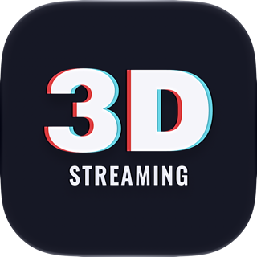

<p align="center"></p>

# S3DSKit

[](LICENSE)


[](#adding-the-package)

Swift package that streams stereo frames (and audio) from a visionOS app to a New Nintendo 3DS running
the [3DSStream](https://github.com/NSCabezon/3DSStream) receiver, shown glasses-free on the 3DS
top screen.

It takes eye images (Metal textures, a RealityKit scene, or ready-made pixel buffers), scales
and rotates them into the 3DS framebuffer layout on the GPU, encodes H.264 Baseline with
VideoToolbox and sends it over TCP (Network.framework). No third-party dependencies.

- Platforms: visionOS 26+ (Swift 6 language mode; works from Swift 5 mode apps too).
- Video/wire contract: [`docs/PROTOCOL.md`](docs/PROTOCOL.md), a copy of 3DSStream's
  `docs/ARCHITECTURE.md`, which is the source of truth.
- License: MIT.

## The stream in one paragraph

Each eye is a 400x240 image rotated 90° clockwise into a 240-wide x 400-tall block (eye pixel
`(x, y)` → block pixel `(column 239 - y, row x)`), so the 3DS hardware decoder writes
framebuffer-ready pixels. The default layout, `.alternating240x400`, sends one eye per H.264
frame, L, R, L, R at twice the stereo rate (60 fps for 30 stereo frames). Keyframes are always
left frames, at least every second, with SPS+PPS before every IDR and no AUD NALs.
`VIDEO_AU` flags: bit0 keyframe, bit1 eye (0 left, 1 right), bit2 alternating. The
`.stacked240x800` layout puts both blocks in one 240x800 frame (left on top); only the
alternating layout has been proven on hardware. The 3DS is the TCP
server on port 7777. The app connects and sends `HELLO`, then `VIDEO_AU`s, and forces an IDR
whenever the 3DS sends `KEYFRAME_REQ`.

## Adding the package

- **Git URL:** Xcode ▸ File ▸ Add Package Dependencies… ▸ `https://github.com/NSCabezon/S3DSKit`,
  rule "Up to Next Major Version" from `0.1.0`. In `Package.swift`:
  ```swift
  .package(url: "https://github.com/NSCabezon/S3DSKit", from: "0.1.0")
  ```
- **Local path:** Add Local… ▸ pick your `S3DSKit` checkout. With XcodeGen:
  ```yaml
  packages:
    S3DSKit:
      path: ../S3DSKit
  targets:
    MyApp:
      dependencies:
        - package: S3DSKit
  ```

**Info.plist (required):** `NSLocalNetworkUsageDescription`, e.g. "Streams 3D video to your
Nintendo 3DS on the local network." Without it visionOS blocks the LAN connection. The Vision
Pro and the 3DS must be on the same Wi-Fi.

## Usage

```swift
import S3DSKit

let streamer = S3DSStreamer()              // hardware-proven defaults, see "Recommended settings"
streamer.connect(host: "192.168.1.50")     // IP shown on the 3DS bottom screen; port 7777
// UI: streamer.connectionState, streamer.stats, streamer.bitrate = 1_500_000, ...
// optional: streamer.isPreviewEnabled = true → streamer.previewImage (800x240 SBS CGImage)
```

`S3DSStreamer` is `@MainActor @Observable` (state for SwiftUI). Its `submit…` methods,
`nextCaptureDue(at:)` and `requestKeyframe()` are `nonisolated` and thread-safe.

### 1. Texture pair: your app already has eye images

Call it every display frame. The built-in throttle passes `framesPerSecond` (default 30) and
returns `false` from extra calls without doing any work. It keeps a fixed cadence (every 2nd call
at 60 Hz, every 3rd at 90 Hz, a 3/4 mix at 100 Hz) and restarts after pauses without a burst. For example, in a frame pump that copies
an emulator's stereo frame each display frame, before `cb.commit()`:

```swift
streamer.submit(left: frame.left, right: frame.right, commandBuffer: cb)
```

- **Sizes**: any. Each eye is fitted into 400x240 per `streamer.frameOptions.fit`.
  `.letterbox` is the default (keeps the aspect ratio with black bars, so 4:3 becomes 320x240
  centered), `.crop` fills and cuts the excess, `.stretch` ignores the aspect ratio. Large
  sources get up to 4x4 bilinear taps per output pixel, so 1920x1440 → 320x240 does not alias.
- **Mono**: `right: nil` shows `left` to both eyes.
- **Formats**: `rgba8Unorm` and `bgra8Unorm` (and other Unorm formats) are copied as-is, so
  they should hold sRGB-encoded color, which is what the 3DS shows. `*_srgb` and float formats
  are read as linear and re-encoded to sRGB. Textures need `.shaderRead` usage and must live on
  `streamer.device` (the system default device unless you pass one to `init`).
- **`commandBuffer`**: if you pass yours, the scale/rotate pass is encoded into it, after your
  rendering. You still commit it, and the library adds a completion handler. If you pass `nil`,
  the library uses its own queue. Either way nothing blocks your thread. Encoding and
  networking run on background queues after the GPU completes.
- `frameOptions.swapEyes` and `frameOptions.flipY` (for bottom-up sources) can be changed live.

### 2. Metal / Compositor Services: let the library own the eye targets

`StereoCamera` gives per-eye view and projection matrices for a 3DS-like camera: IPD 0.063 m ×
`depthMultiplier`, 40° vertical FOV, 5:3, reverse-Z, and convergence at 1.5 m by default
(`nil` for parallel eyes). `StereoEyeRenderer` owns triple-buffered 400x240 color and depth
targets and calls your draw code once per eye:

```swift
import ARKit
import CompositorServices
import S3DSKit

final class StreamCapture {
    let streamer: S3DSStreamer
    let eyes: StereoEyeRenderer          // .bgra8Unorm_srgb + .depth32Float by default
    var camera = StereoCamera()
    let scenePipeline: MTLRenderPipelineState   // built with eyes.colorPixelFormat/depthPixelFormat
    let depthState: MTLDepthStencilState         // compare .greater (reverse-Z)

    // Call from the Compositor Services render loop, after rendering the drawables.
    func captureIfDue(commandBuffer: MTLCommandBuffer, deviceAnchor: DeviceAnchor?, time: Double) {
        guard streamer.nextCaptureDue() else { return }          // cheap when not due
        let head = deviceAnchor?.originFromAnchorTransform ?? matrix_identity_float4x4
        let textures = eyes.render(commandBuffer: commandBuffer, camera: camera,
                                   headTransform: head) { encoder, eye in
            encoder.setRenderPipelineState(self.scenePipeline)
            encoder.setDepthStencilState(self.depthState)
            // Same scene draw as for the wearer, with this eye's matrices:
            drawScene(encoder, view: eye.view, projection: eye.projection, time: time)
        }
        streamer.submit(textures, commandBuffer: commandBuffer, throttle: false)
    }
}
// In the frame loop: render each drawable view, then
//   capture.captureIfDue(commandBuffer: cb, deviceAnchor: anchor, time: t)
//   drawable.encodePresent(commandBuffer: cb); cb.commit(); frame.endSubmission()
```

The streamer is a `@MainActor` class, but `nextCaptureDue()` and `submit` are `nonisolated`, so
the render thread can call them directly. Keep a reference to the streamer and create it on the
main actor.

### 3. RealityKit

`S3DSRealityCapture` renders entities with an offscreen `RealityRenderer`, using one
`PerspectiveCamera` render per eye:

```swift
let capture = try S3DSRealityCapture(streamer: streamer)
capture.renderer.entities.append(sceneCopy)   // an entity can be in one scene only: use a clone
// every frame (main actor):
try capture.capture(headTransform: headPose, deltaTime: dt)
```

`PerspectiveCamera` frusta are symmetric, so the eyes are parallel and `convergenceDistance` is
ignored. Tested in the simulator: a box renders into both eyes.

### 4. Pre-rotated pixel buffers (advanced)

`submit(pixelBuffer:eye:)` takes 32BGRA, sRGB-encoded buffers already in the layout: 240x400
with `eye: .left` and then `.right` for the alternating layout, or one 240x800 buffer with
`eye: nil` for stacked. `RotationMapping` has the pixel mapping.

### 5. Audio

Audio goes out on the same connection as the video. The library encodes it as Opus at 48 kHz
stereo, in 20 ms packets (960 frames) at 96 kbps by default (`audioBitrate`). Each packet is
sent as an `AUDIO` (0x03) message: a big-endian µs timestamp followed by the Opus packet. The
timestamp uses the same clock as the video frames (`CACurrentMediaTime`, i.e.
`mach_absolute_time`). Audio is on by default; turn it off with
`S3DSConfiguration(audioEnabled: false)`. Submissions are ignored while not connected.

The submit calls are **real-time safe**. They only copy into a ring buffer, holding an
`os_unfair_lock` for the copy and allocating nothing. Resampling, upmixing and encoding run on
a background queue. Any sample rate works; mono is sent to both channels.

Example: a game core that produces mono Float32 at 48 kHz on its audio thread. Hand each
rendered block to the streamer from that same callback:

```swift
// inside the audio render block, after filling `out` (frameCount mono Float32 samples):
streamer.submitAudio(samples: UnsafeBufferPointer(start: out, count: Int(frameCount)),
                     channels: 1, sampleRate: 48_000)
```

Other inputs: `submitAudio(_ buffer: AVAudioPCMBuffer, hostTime:)` takes Float32 or Int16
buffers, interleaved or not (for example from an `AVAudioEngine` tap; pass `when.hostTime`).
Interleaved stereo works with `submitAudio(samples:channels: 2, sampleRate:)`.

To check the input rate, read `stats.audioInputFramesPerSecond` (frames per channel per second
of wall-clock time, last ~2 s; it should equal the `sampleRate` you declare, e.g. 48000),
`stats.audioPacketsPerSecond` (50 for real-time input) and `stats.audioDroppedInputFrames`
(input lost in the ring, normally 0). A rate above the declared one means the app produces audio
faster than real time and the 3DS will receive more audio than it can play.

Audio is never dropped by the video congestion logic, only when the connection is down. Sends
are asynchronous, but audio and video share one TCP stream, so audio waits behind any video
already queued. That is why congestion is handled by skipping video before it is encoded (see
[Congestion](#congestion)): the backlog ahead of audio stays around 150 ms, well inside the
receiver's ~300 ms audio budget.

## Recommended settings / hardware notes

The defaults are the settings proven on a New 3DS XL: 29.9 stereo pairs/s with 0 decode errors.
See [`docs/ARCHITECTURE.md` › Hardware findings](docs/PROTOCOL.md#hardware-findings-new-3ds-xl-2026-10-14).

| Setting | Default | Notes |
|---|---|---|
| `layout` | `.alternating240x400` | The 3DS MVD decoder crashes on 240x800. |
| `framesPerSecond` | 20 stereo pairs | 40 encoded fps (L, R, L, R…). 30 pairs worked on a New 3DS XL with x264; lowered after Vision Pro device runs. |
| `bitrate` | 1.2 Mbps | Clamped to 0.5–3 Mbps. Above ~2 Mbps risks stalls over the 3DS's Wi-Fi (2.5 Mbps stalled). With `adaptiveBitrate` it is the ceiling. |
| `adaptiveBitrate` | `true` | Steps the encoder bitrate down (×0.8, floor 0.5 Mbps) while more than 20 % of the pairs of a 2 s window are skipped for congestion or its average backlog is ≥ 100 ms, and back up (×1.1 every 5 s without congestion) to `bitrate`. `setStartBitrate(_:)` starts lower. |
| `keyframeInterval` | 2 × `framesPerSecond` | An IDR every 2 s (80 encoded frames), always on a **left** frame, with SPS+PPS before each IDR. Forced IDRs (connect, `KEYFRAME_REQ`, oversize/multi-slice drops) are rate-limited to 1 per second. |
| `maxInFlightFrames` | ≈ 450 ms | 9 pairs = 18 AUs at the default rate. Last-resort cap on encoded video waiting for the network; see [Congestion](#congestion). |
| `audioBitrate` | 96 kbps | Opus, 48 kHz stereo, 20 ms. |
| `encoder` | `.automatic` | Software H.264 encoder (see below). |

The library always enforces the following:

- **Exactly one slice per picture.** The MVD decoder corrupts and then crashes on
  multi-slice frames. VideoToolbox's software H.264 encoder (used in the simulator) emits 2–5
  slices by default. S3DSKit sets the session property `NumberOfSlices = 1`, which
  `VTSessionCopySupportedPropertyDictionary` lists but has no public constant, and never sets
  `MaxH264SliceBytes`.
  - It also checks every picture. A multi-slice picture is logged (`log.fault`) and dropped, an
    IDR is requested, and `stats.multiSlicePicturesDropped` counts it. From a software session
    it also triggers an assertion in DEBUG.
  - **Software encoder by default** (`encoder: .automatic`): the Vision Pro's hardware H.264
    encoder was suspected of ignoring `NumberOfSlices` (being verified on device). On a real Vision
    Pro, VideoToolbox ignores the software request and uses the hardware encoder, which so far
    emitted no multi-slice pictures. 240x400 costs little CPU (~5 ms average latency per frame
    at 60 fps in the simulator). If a hardware session is ever in use (software unavailable) and
    emits a multi-slice picture, the session is rebuilt once on the software encoder.
    `.software` never uses hardware; `.hardware` is VideoToolbox's default choice, and its
    multi-slice pictures are only dropped. `stats.encoderIsHardware` shows which one is running,
    and the session's choice is logged (`Logger` subsystem `S3DSKit`, category `encoder`).
- H.264 Baseline, no B-frames (`AllowFrameReordering = false`), no AUD or SEI NALs.
- **Zero output delay in the SPS.** VideoToolbox writes a VUI without `bitstream_restriction`,
  so a decoder may assume reordering and hold pictures before output. On the 3DS that desynced
  the eyes (the right eye showed an older picture). S3DSKit rewrites every SPS it sends to add
  `bitstream_restriction` with `max_num_reorder_frames = 0` and
  `max_dec_frame_buffering = max(1, max_num_ref_frames)` (like x264), all other fields unchanged.
  An SPS it cannot parse is sent unchanged and logged once. It also asks for
  `ReferenceBufferCount = 1` where the encoder supports it (the simulator's does not).
- A `VIDEO_AU` payload may be at most 256 KiB, the receiver's limit. A larger AU is dropped and an
  IDR is forced on the next left frame. An `AUDIO` payload may be at most 4 KiB.

## Threading notes

- `S3DSStreamer` state (`connectionState`, `stats`, `previewImage`, `bitrate`, `frameOptions`)
  is main-actor. Frame input is thread-safe and never blocks. The library never calls
  `waitUntilCompleted`.
- `StereoEyeRenderer.render` must be called from one thread at a time. `S3DSRealityCapture` is
  main-actor.
- At most 3 stereo frames are in flight on the GPU. Network congestion skips whole pairs
  before they reach the GPU or the encoder; see [Congestion](#congestion). Audio is exempt.
- `connect` does not retry on its own. On failure `connectionState` is `.failed(reason)`. Call
  `connect` again, for example from a button.

## Congestion

A 3DS on Wi-Fi sustains roughly 0.9 Mbps, sometimes less. When the stream produces more than
the link carries, S3DSKit keeps the latency bounded without breaking the H.264 stream:

1. **Skip before encoding, per stereo pair.** The sender estimates the backlog ahead of a new
   frame: the larger of the age of the oldest video AU still queued in Network.framework, and
   the bytes waiting there plus the unacknowledged bytes in the TCP send buffer (sampled every
   10 ms) at the stream's bitrate. While it is ≥ 150 ms, a pair that falls due is skipped: never
   rotated, never encoded. The reference chain stays intact, so the stream continues with the
   next pair and needs no keyframe. Both eyes of a pair are always skipped together.
   `stats.congestionPairsSkipped` counts them.
2. **Last resort after encoding.** Only if the backlog still reaches 450 ms (3×), or
   `maxInFlightFrames`, is an encoded left (or stacked) frame dropped; a right frame whose left
   was sent is never dropped for backpressure, so pairs stay whole on the wire. The sender then
   waits for a keyframe and asks for one as soon as the backlog drains below 150 ms, rather than
   waiting up to 2 s for the scheduled IDR, and never while still congested (IDR storms). A
   `KEYFRAME_REQ` from the receiver is held back the same way. Forced IDRs stay limited to 1 per
   second, on left frames.
3. **Adaptive bitrate** (`adaptiveBitrate`, on by default). Skipping alone does not lower the
   bitrate much: VideoToolbox's rate control spends the same bits per second on fewer frames. So
   while more than 20 % of the pairs in a 2 s window are skipped, or the backlog averaged over
   the window is at least 100 ms (a link just under the bitrate skips few pairs but stays backed
   up), the bitrate drops by 20 %, or straight to what fits the link if that is lower: 85 % of
   what the 3DS acknowledged over the window, minus audio, divided by how far the encoder ran
   over its target (hardware encoders overshoot by 20-50 %) (floor 0.5 Mbps); after 5 s without a skip or a backed-up
   window it rises by 10 %, up to `bitrate`. `stats.videoBitrate` is the value in use. To skip
   the first seconds of stepping down on a known link, call `setStartBitrate(_:)` after
   connecting with the rate that last worked (for example a saved `stats.videoBitrate`).

The engine logs one line per second (`Logger` subsystem `S3DSKit`, category `engine`) while
connected, for example:

```
video/s: submitted 40 encoded 40 sent 40 keys 0 dropped 0 pairs-skipped 0; 1150 kbps (bitrate 1200 kbps); in-flight 0 backlog 12 ms (socket 1 KiB); encode 2.3 ms avg (hw)
drops/s: congestion-skipped pairs 3 backpressure 0 awaiting-keyframe 0 oversize 0 multi-slice 0 (totals 41/0/0/0/0; recovery IDRs 1)
```

The second line appears only in seconds with a skip or a drop. On a healthy link
`pairs-skipped` and `dropped` stay at 0. A few skipped pairs right after an IDR are normal on a
link near its limit; steady skipping with `bitrate` stepping down means the link carries less
than the configured bitrate.

## Building and testing

```sh
cd visionos
xcodebuild build -scheme S3DSKit -destination 'platform=visionOS Simulator,name=Apple Vision Pro'
xcodebuild test  -scheme S3DSKit -destination 'platform=visionOS Simulator,name=Apple Vision Pro'
```

`swift test` cannot run visionOS tests, so use `xcodebuild`. The suite covers:

- protocol framing, AVCC→Annex-B, the SPS `bitstream_restriction` rewrite, slice counting, mapping, fit and letterbox math, camera math,
  and the hardware defaults;
- GPU kernel exactness, pixel by pixel, for both layouts;
- encoder keyframe placement (IDR only on left frames, deferred requests);
- the frame throttle (60/90/100/120 Hz, jitter, pauses) on a synthetic clock; audio stats
  (input rate, packet rate, ring drops);
- Opus at 50 packets/s with 20 ms timestamps, from 48 kHz and from 44.1 kHz input, decoded back
  to a 440 Hz sine; the audio ring buffer;
- end-to-end loopback streaming to a fake 3DS, for alternating (with interleaved audio, decoded
  back to 440 Hz, and one slice per AU), stacked, mono 1920x1440 at 90 Hz (throttle) and
  preview;
- congestion, with a fake 3DS that reads slowly and then catches up: pairs are skipped before
  the encoder sees them, no right frame goes out without its left, video flows again as soon as
  the link clears (no keyframe wait), IDRs stay ≥ 1 s apart, and the bitrate steps down and back
  up; the last-resort drop recovers with an IDR requested once the backlog drains; the
  congestion controller on a synthetic clock;
- the RealityKit adapter.

The end-to-end tests write what they received to the simulator's temp dir and print
`S3DSKIT_DUMP <name>: <path>`. Inspect a dump with:

```sh
ffprobe -v error -show_streams -count_frames <path>/s3ds_alternating.h264   # 240x400 Constrained Baseline
ffmpeg -i <path>/s3ds_alternating.h264 -vf "select=between(n\,40\,41),transpose=cclock,tile=2x1" -frames:v 1 pair.png
```

Use 3DSStream's `tools/recv_sim.py` as a fake 3DS on the Mac when testing a real app in the simulator.
